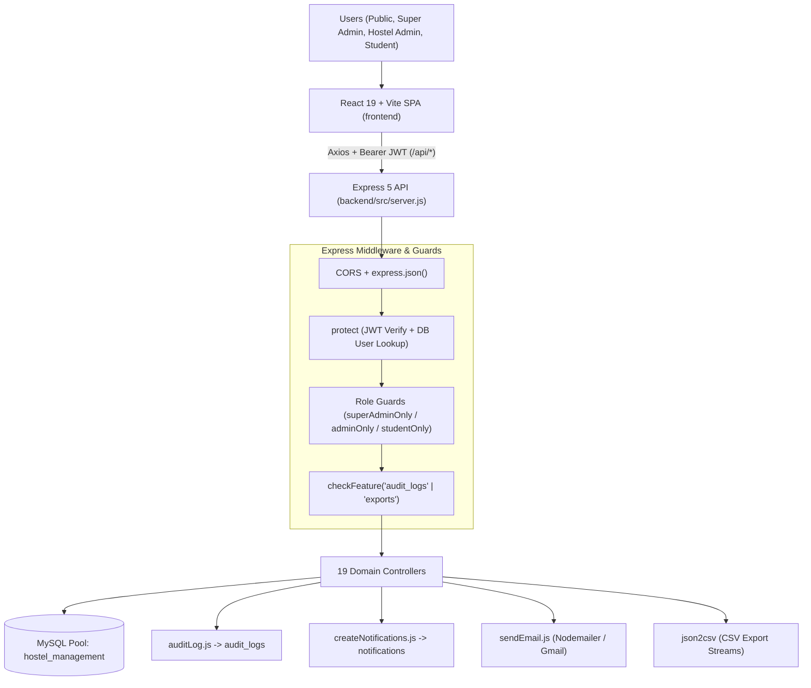
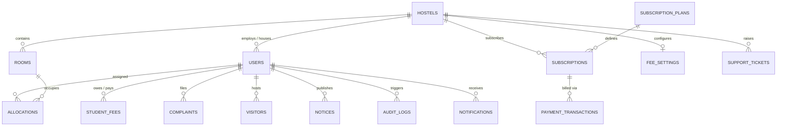
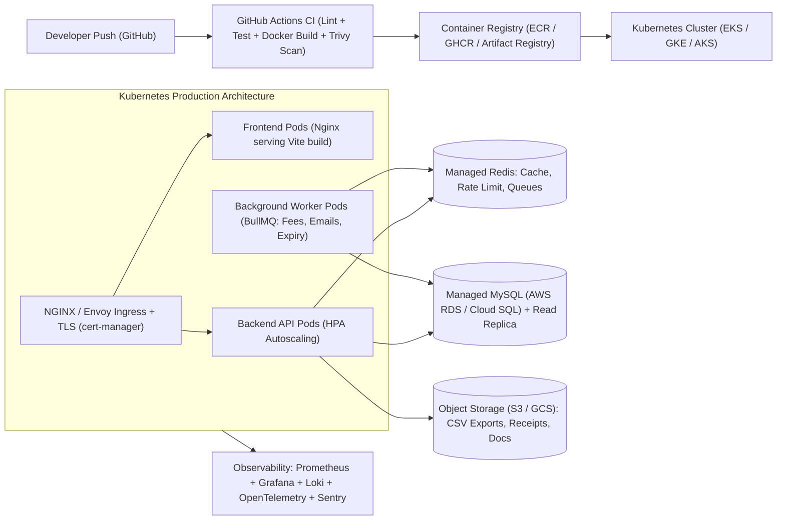

# StaySync — Hostel Management System: Architecture, Improvements & Modernization Roadmap

StaySync is a multi-tenant SaaS **Hostel Management System** built to manage multiple hostels from a single platform with strict tenant isolation (`hostel_id`), role-based access control (`super_admin`, `admin`, `student`), subscription-based feature gating, room allocation transactions, student fee tracking, visitor logs, complaints, notices, support tickets, and analytics.

---

## 1. Current System Overview

### Tech Stack
| Layer | Current Technology | Notes |
| :--- | :--- | :--- |
| **Frontend** | React 19, Vite 8, React Router v7, Tailwind CSS v4 | Icons via `lucide-react` & Tabler icons CDN; charts via `recharts` and `chart.js` / `react-chartjs-2` |
| **HTTP Client** | Axios (`frontend/src/services/api.js`) | Points to `http://localhost:2000/api`; attaches `Bearer` JWT from `localStorage` |
| **Backend** | Node.js (CommonJS), Express 5 | Entry point at `backend/src/server.js` |
| **Database** | MySQL (`mysql2` connection pool) | Database `hostel_management`; raw SQL queries inside controllers (`models/` and `services/` are empty; `mongoose` is in `package.json` but unused) |
| **Auth & Security** | `jsonwebtoken` (1h expiry), `bcrypt`, `cors` | Role middlewares + subscription feature-flag middleware |
| **Utilities** | `nodemailer` (Gmail), `json2csv` | Demo-request confirmation emails and CSV report exports |

---

## 2. High-Level Architecture

### Key Architectural Patterns
1. **Multi-Tenancy via Row-Level `hostel_id` Isolation**:
   - Almost every domain table (`users`, `rooms`, `allocations`, `fee_settings`, `student_fees`, `subscriptions`, `payment_transactions`, `complaints`, `notices`, `visitors`, `support_tickets`, `audit_logs`, `notifications`) includes a `hostel_id` column.
   - `admin` and `student` queries scope data using `req.user.hostel_id` extracted from the authenticated user record in `protect` (`backend/src/middleware/authMiddleware.js`).
2. **Role-Based Access Control (RBAC)**:
   - **`super_admin`**: Platform-wide visibility—manages hostels, hostel admins, subscription plans, demo requests, business revenue insights, and escalated support tickets.
   - **`admin` (Hostel Admin)**: Manages one hostel—students, rooms, allocations, fee settings/collection, visitors, complaints, notices, CSV exports, and support tickets.
   - **`student`**: Self-service portal—views dashboard, active room allocation, fee statements, hostel notices, notifications, and submits/tracks personal complaints.
3. **Subscription Plan & Feature Gating**:
   - `subscription_plans` stores `price`, `max_employees`, `duration_days`, and a `features` JSON array (e.g., `students`, `rooms`, `allocations`, `visitors`, `complaints`, `notices`, `analytics`, `audit_logs`, `exports`).
   - **Login Gate**: `admin` login (`authController.js`) rejects authentication (`403`) if the hostel has no `active` or `trial` subscription with `end_date >= NOW()`.
   - **Quota Gate**: `createHostelAdmin` (`hostelController.js`) checks `COUNT(*) FROM users WHERE hostel_id = ? AND role != 'student'` against `max_employees`.
   - **Server-Side Feature Gate**: `checkFeature(featureName)` protects `GET /api/audit-logs` (`audit_logs`) and `GET /api/reports/*` (`exports`).
   - **Client-Side Feature Gate**: On `admin` login and plan purchase, `features` is stored in `localStorage` and checked by pages such as `AnalyticsAdminRoute.jsx`.
4. **Transactional Integrity**:
   - Multi-step mutations run inside explicit MySQL transactions (`beginTransaction`, `commit`, `rollback`):
     - `createHostel` (`hostelController.js`): Creates hostel + initial subscription.
     - `createAllocation` (`allocationsController.js`): Inserts allocation, increments `rooms.current_occupancy`, and auto-generates `security_deposit` and `monthly_fee` rows in `student_fees` if `fee_settings` exist.
     - `vacateStudent` (`allocationsController.js`): Marks allocation `vacated`, sets `vacated_at`, and decrements `rooms.current_occupancy`.
     - `purchasePlan` (`subscriptionsController.js`): Cancels active/trial subscription, inserts `payment_transactions`, creates new active subscription, and links `subscription_id`.

---

## 3. Database Entity Model (Observed from SQL Queries)

---

## 4. API Modules & Frontend Route Map

### Backend Routes (`backend/src/server.js`)
| Base Path | Controller | Responsibilities |
| :--- | :--- | :--- |
| `/api/auth` | `authController` | `POST /login` with bcrypt verification + admin subscription check |
| `/api/hostels` | `hostelController` | Super Admin: create/list/update hostels, create/list hostel admins |
| `/api/students` | `studentsController` | Admin: CRUD & dropdown for students; Student: `GET /allocation-details` |
| `/api/rooms` | `roomController` | Admin: create/list/detail/update room capacity |
| `/api/allocations` | `allocationsController` | Admin: allocate room (auto-generates fees), list/detail, vacate student |
| `/api/fees` | `feesController` | Admin: fee settings, all fees, analytics, recent activity, mark paid; Student: `my-fees` |
| `/api/plans` | `plansController` | Super Admin: CRUD plans; Authenticated: list plans |
| `/api/subscriptions` | `subscriptionsController` | Super Admin: list/detail all subscriptions; Admin: current/history/purchase plan; Payment history |
| `/api/dashboard` | `dashBoardController` | Role-specific metrics (`super-admin`, `hostel-admin`, `student`) |
| `/api/businessInsights` | `businessInsightController` | Super Admin: total revenue, average revenue per hostel, recent payments, top hostels |
| `/api/complaints` | `complaintsController` | Student: create & list own; Admin: list hostel complaints & update status |
| `/api/notices` | `noticesController` | Admin: create/delete notices; Admin & Student: list hostel notices |
| `/api/visitors` | `visitorsController` | Admin: register visitor, list visitors, check out visitor |
| `/api/reports` | `reportsController` | Admin (`exports` feature): CSV export for students, allocations, visitors |
| `/api/supportTickets` | `supportTicketsController` | Admin: create/list own tickets; Super Admin: list all & respond/update status |
| `/api/demos` | `homeController` | Public: submit demo request (+ email); Super Admin: list & update status |
| `/api/audit-logs` | `auditLogsController` | Super Admin & Admin (`audit_logs` feature): view action history |
| `/api/notifications` | `notificationsController` | Role-scoped list, mark single read, mark all read |
| `/api/settings` | `settingsController` | Profile view/update, password change, hostel settings view/update |

### Frontend Pages (`frontend/src/App.jsx`)
- **Public**: `/` (`HomePage.jsx`), `/login` (`LoginRoute.jsx`)
- **Super Admin**: `/super-admin`, `/hostels`, `/admins`, `/super-admin/subscriptions`, `/business-insights`, `/demo-requests`, `/super-admin/analytics`
- **Hostel Admin**: `/hostel-admin`, `/students`, `/rooms`, `/allocations`, `/fee-management`, `/admin/subscriptions`, `/visitors`, `/admin/analytics`
- **Shared / Role-Adapted**: `/notices`, `/complaints`, `/support-tickets`, `/audit-logs`, `/notifications`, `/settings`, `/profile`
- **Student**: `/student`, `/allocation-details`, `/my-fees`

---

## 5. Immediate Fixes & Code-Level Improvements

Before scaling to containers or cloud infrastructure, address these concrete issues observed in the current codebase:

### A. Security & Configuration Fixes (High Priority)
1. **Remove Hardcoded Secrets & DB Credentials**:
   - `backend/src/config/mysql.js` hardcodes `host: "localhost"`, `user: "root"`, `password: "Bhanu123@"`. Move all DB config to `process.env.DB_HOST`, `DB_USER`, `DB_PASSWORD`, `DB_NAME`.
   - `authMiddleware.js` and `generateToken.js` hardcode `secretKey = "your-very-secure-secret"`. Load `process.env.JWT_SECRET` (and fail fast at startup if missing).
   - Remove the duplicate `app.use("/api", authRoutes)` test mount in `backend/src/server.js`.
2. **Harden Auth & Route Guards**:
   - In `protect` (`authMiddleware.js`), check `if (rows.length === 0) return res.status(401)...` before calling `next()` so deleted users cannot cause `Cannot read properties of undefined`.
   - Enforce `end_date >= NOW()` inside `checkFeature` (`authMiddleware.js`) and `currentPlan` (`subscriptionsController.js`)—currently only `authController.js` checks `end_date >= NOW()`.
   - Add role-aware route protection on the frontend (`ProtectedRoute.jsx` currently only checks token existence, not `user.role`), plus an Axios 401 response interceptor in `api.js` to handle expired 1h JWTs gracefully (redirect to `/login` or use refresh tokens).
   - Add `helmet`, `express-rate-limit` (especially on `/api/auth/login` and `/api/demos`), and CORS origin allow-listing (`CORS_ORIGIN` env var).

### B. Bug Fixes Observed in Existing Endpoints/UI
1. **CSV Visitor Export Column Mismatch** (`reportsController.js`): SQL selects `v.visitor_phone`, while `json2csv` fields specify `"mobile"`. Align the field name to `"visitor_phone"` (or alias `v.visitor_phone AS mobile`).
2. **`deleteNotice` Query Bug** (`noticesController.js`): `SELECT title FROM notices WHERE hostel_id=?` lacks `AND id = ?`, which logs the wrong notice title (or crashes if empty).
3. **`changePassword` Null Check Bug** (`settingsController.js`): `if (rows[0].length === 0)` should be `if (rows.length === 0)`.
4. **Transaction Cleanup in `purchasePlan`** (`subscriptionsController.js`): `currentSubscription[0].plan_id === plan_id` compares a DB integer to a URL string param after `beginTransaction()`, and returns 400 without `connection.rollback()`. Validate before starting the transaction and compare `Number(plan_id)`.
5. **Frontend Consistency Fixes**:
   - `SuperAdminDashboard.jsx` falls back to `"/dashboard/admin"` instead of `"/dashboard/hostel-admin"`.
   - `AnalyticsSuperAdminRoute.jsx` uses hardcoded `[8, 15, 5]` for `planDistributionData` instead of real plan counts from the backend.
   - `AuditLogs.jsx` calls `api.get("http://localhost:2000/api/audit-logs")` (full hardcoded URL instead of relative `"/audit-logs"` via `VITE_API_URL`) and filters on `log.action_time` instead of `log.action`.
   - Standardize frontend API base URL using `import.meta.env.VITE_API_URL`.

### C. Backend Code Structure & Data Layer
1. **Layered Architecture**: Move raw SQL out of controllers into `src/services/` and `src/repositories/` (or an ORM/query builder like **Prisma**, **Drizzle ORM**, or **Knex.js**).
2. **Database Migrations & Seeding**: Introduce versioned SQL migrations (Prisma Migrate, Knex, or Flyway/Liquibase) instead of an untracked manual schema. Add indexes on `(hostel_id, status)`, `(email)`, and foreign keys.
3. **Request Validation & Error Handling**: Add **Zod** or **Joi** schema validation middleware and a centralized Express error-handling middleware so controllers don't repeat boilerplate `try/catch` blocks.
4. **Recurring Monthly Fee Automation**: Currently `allocationsController.js` only inserts the first `monthly_fee` at allocation time. Add a scheduled job (cron / queue worker) to generate monthly fee invoices on the 1st of each month for all `active` allocations.
5. **Real Payment Gateway Integration**: Replace the stubbed `"DEMO_${Date.now()}"` payment in `subscriptionsController.js` with real **PayU / Razorpay / Stripe** checkout + webhook signature verification (and idempotency keys).
6. **Clean Up Unused Artifacts**: Remove `mongoose` from `backend/package.json` (unused), remove the stray `git status` file in the repo root, and add ESLint + Prettier + automated tests (**Vitest** / **Jest** + **Supertest** + **Playwright**).

---

## 6. Recommended Tech Stack & Infrastructure to Take StaySync to the Next Level

To evolve StaySync from a local prototype into a production-grade, resilient, scalable SaaS platform, adopt the following tools in staged phases:

### 1. Containerization: Docker & Docker Compose
- **Why**: Eliminates "works on my machine" issues across MySQL versions, Node versions, and environment variables.
- **How**:
  - **Backend `Dockerfile`**: Multi-stage `node:22-alpine` image running as a non-root user, exposing port `2000`, with a `/health` readiness endpoint.
  - **Frontend `Dockerfile`**: Multi-stage build (`node:22-alpine` to run `npm run build` with `VITE_API_URL`, copied into `nginx:alpine` with SPA fallback `try_files $uri /index.html`).
  - **`docker-compose.yml` (Local Dev)**: Spins up `mysql:8.4` (with an init/migration volume), `redis:7-alpine`, `backend`, `frontend`, and `mailhog` (to test Nodemailer emails locally without Gmail credentials).

### 2. Caching, Queues & Background Jobs: Redis + BullMQ
- **Why**:
  - Subscription `features` and `dashboard` stats are queried repeatedly—cache them in **Redis** with short TTLs and invalidate on plan change/allocation.
  - Sending emails (`nodemailer`), generating large CSV reports, checking expired subscriptions, and billing monthly student fees shouldn't block HTTP requests. Offload them to **BullMQ** worker queues backed by Redis.
  - Replace in-memory rate limiting with Redis-backed rate limiting across multiple backend replicas.

### 3. CI/CD Automation: GitHub Actions
- Automate every pull request and `main` merge:
  1. **Quality & Security**: `eslint`, `vitest`/`jest` unit + integration tests (using a test MySQL container or Testcontainers), `npm audit`, and `Trivy` container vulnerability scanning.
  2. **Build & Push**: Build versioned Docker images tagged with Git SHA and push to **GitHub Container Registry (GHCR)** or **AWS ECR**.
  3. **Deploy**: Automated deployment to staging on merge and gated production rollout.

### 4. Cloud Platform Architecture (AWS / GCP / Azure)
Instead of self-hosting MySQL and state on a single VM, use managed cloud primitives:
- **Database**: **AWS RDS for MySQL** (or Google Cloud SQL) with Multi-AZ failover, automated daily backups, and point-in-time recovery.
- **Object Storage**: **AWS S3 / Cloudflare R2 / GCS** for storing generated fee receipts (PDF), student ID documents, and async report exports via signed URLs.
- **Secrets Management**: **AWS Secrets Manager / GCP Secret Manager / HashiCorp Vault** (never `.env` files baked into images).
- **CDN & Edge**: **Cloudflare** or **AWS CloudFront** in front of the React static bundle for global edge caching, WAF protection, and DDoS mitigation.
- **Transactional Email**: Replace personal Gmail SMTP in `sendEmail.js` with **Amazon SES**, **Resend**, or **Postmark** with SPF/DKIM/DMARC configured.

### 5. Orchestration: Kubernetes (EKS / GKE) & Helm / GitOps
Once traffic or enterprise SLA requirements justify orchestration beyond a PaaS (like ECS/Cloud Run):
- **Deployments & Services**: Separate `frontend`, `backend-api`, and `worker` Deployments packaged via **Helm** or **Kustomize**, synced via **ArgoCD** (GitOps).
- **Autoscaling**: **HorizontalPodAutoscaler (HPA)** on CPU/memory/request-latency for API pods.
- **Ingress & TLS**: **NGINX Ingress Controller** + **cert-manager** (Let's Encrypt) for automatic HTTPS termination and `/api` path routing (eliminating CORS headaches in production).
- **Zero-Downtime Deploys**: Readiness/liveness probes (`/healthz`, `/readyz`), `PodDisruptionBudgets`, and `preStop` hooks to drain active MySQL connections cleanly.
- **Scheduled CronJobs**: Kubernetes `CronJob` (or BullMQ repeatable jobs) for:
  - Expiring `subscriptions` where `end_date < NOW()`
  - Sending 7-day / 1-day renewal reminder emails
  - Monthly `student_fees` generation

### 6. Observability, Logging & Monitoring
- **Structured Logging**: Replace `console.log` with **Pino** or **Winston** outputting JSON logs enriched with `requestId`, `userId`, and `hostelId`.
- **Metrics & Dashboards**: **Prometheus + Grafana** (HTTP latency p95/p99, error rates, MySQL pool saturation, active queue depth).
- **Tracing & Error Tracking**: **OpenTelemetry** for distributed traces across API -> MySQL -> Redis, plus **Sentry** for frontend and backend exception alerting.

### 7. Product & SaaS Feature Upgrades ("Next Level")
- **Self-Service Hostel Onboarding & Billing**: Allow new hostel owners to sign up directly from `HomePage`, verify email, start a 14-day trial, and pay via **Razorpay / Stripe / PayU** webhooks.
- **Online Student Fee Payments**: Allow students to pay `monthly_fee` and `security_deposit` online directly from `/my-fees` with downloadable PDF invoices.
- **Real-Time Notifications**: Upgrade the 60-second polling in `Layout.jsx` to **WebSockets (Socket.io)** or **Server-Sent Events (SSE)** backed by Redis Pub/Sub.
- **Multi-Admin & Staff Roles (RBAC v2)**: Split `admin` into granular permissions (`Owner`, `Warden`, `Accountant`, `Security/Gatekeeper` for visitor logs).
- **Audit Log Immutability & Filtering**: Add server-side pagination, date-range filters, and CSV export on `/api/audit-logs` instead of loading all logs into memory on the client.

---

## 7. Recommended Phased Execution Plan

| Phase | Focus | Concrete Deliverables |
| :--- | :--- | :--- |
| **Phase 1: Stabilize & Secure** | Code quality & bugs | Env-based secrets/DB config, fix the 5 controller/UI bugs, add Zod validation, centralized error handler, ESLint, and API integration tests |
| **Phase 2: Containerize & Automate** | Reproducibility | Multi-stage Dockerfiles (`frontend` + `backend`), `docker-compose.yml` (MySQL + Redis + Mailhog), Prisma/Knex DB migrations, GitHub Actions CI |
| **Phase 3: Cloud & Scale** | Production readiness | Managed MySQL (RDS/Cloud SQL), Redis + BullMQ workers (monthly fees, emails, subscription expiry), Pino + Sentry + Prometheus/Grafana, real payment webhooks |
| **Phase 4: Kubernetes & Enterprise SaaS** | High availability | Helm/ArgoCD deployment on EKS/GKE, HPA autoscaling, TLS Ingress, SSE/WebSocket notifications, PDF receipts on S3, and granular staff RBAC |
